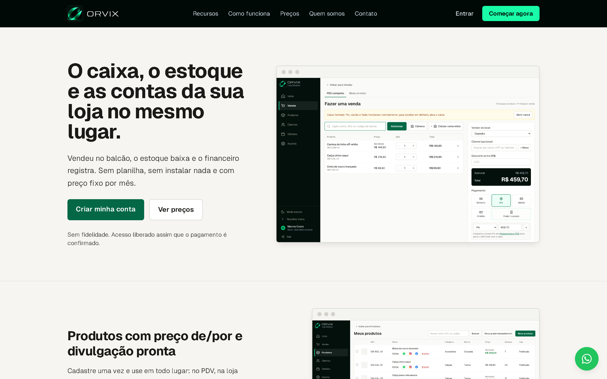
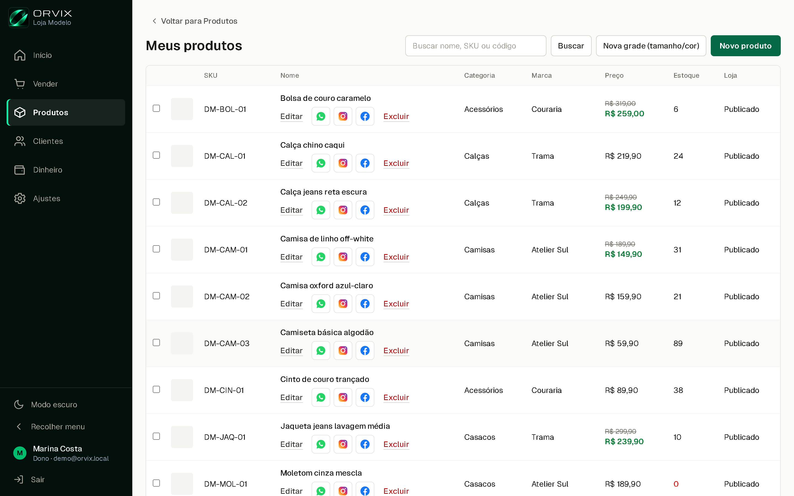
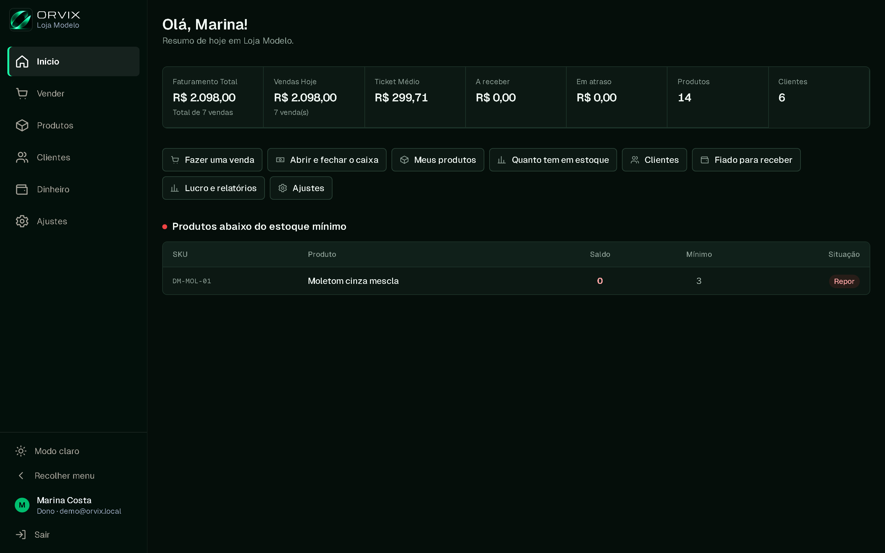
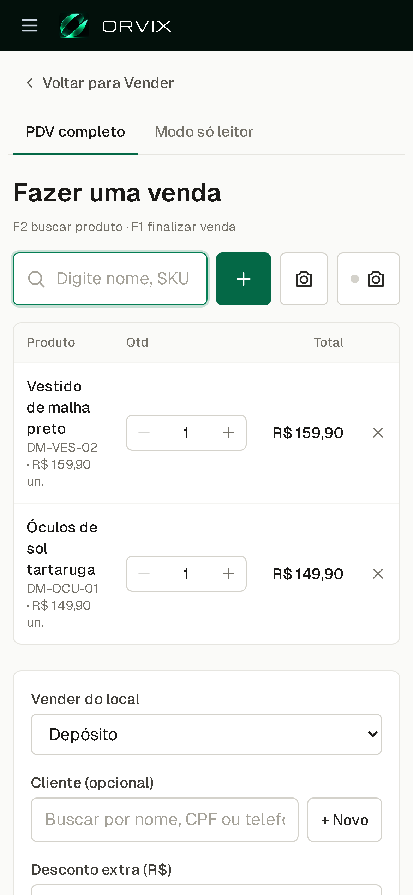

# Orvix

**Sistema de gestão (ERP) para lojas: PDV, estoque, financeiro, relatórios e loja online num lugar só.**

Em uso numa loja real e vendido como assinatura (várias empresas no mesmo sistema).
*Este repositório é uma vitrine: o código é privado. Os prints usam uma loja de demonstração com dados fictícios.*

## O problema

Lojas pequenas controlam vendas no caderno, estoque na planilha e contas no aplicativo do banco. Nada conversa: o estoque não bate, o lucro do mês é um chute e o fechamento do caixa toma tempo.

## A solução

Um sistema web em que **cada venda baixa o estoque e entra no financeiro sozinha**, com telas pensadas para quem não tem costume com computador.

| Venda no PDV | Painel do dia |
|---|---|
|  |  |

| Produtos com preço de/por | Lucro e DRE do mês |
|---|---|
|  |  |

| Modo escuro | No celular |
|---|---|
|  |  |

## Funcionalidades

- **Vendas:** PDV com leitor de código de barras, câmera do celular, Pix com QR Code, cartão, dinheiro e fiado; caixa com abertura, sangria e fechamento; modo só leitor em tela cheia
- **Estoque:** vários locais, transferências, inventário com contagem simultânea, lista de compras por fornecedor, entrada pela nota fiscal (XML da NF-e)
- **Por ramo de negócio:** grade de tamanho e cor, validade e lote, número de série/IMEI, venda por peso
- **Financeiro:** contas a pagar e a receber, cartões a receber por maquininha, DRE
- **Vendas online:** loja com o mesmo estoque, pedido pelo WhatsApp, frete; Mercado Livre e Mercado Pago
- **Divulgação:** mensagem pronta para WhatsApp e geração de posts para Instagram e Facebook
- **Equipe:** perfis Dono, Administrador, Gerente, Caixa, Estoquista e Consulta

## Decisões técnicas

- **Várias empresas no mesmo banco** com filtro automático por empresa em toda consulta (a consulta falha se a empresa não for identificada); Row Level Security ligado em todas as tabelas para fechar o acesso direto pela API do banco
- **Transações atômicas** em estoque e financeiro (venda, entrada de nota, inventário)
- **Segurança:** verificação em duas etapas, CSRF, limite de tentativas, cabeçalhos de segurança e CSP com nonce
- **LGPD:** exportar e excluir os dados pessoais de um cliente, coleta mínima, senhas com bcrypt, backup diário
- **Usabilidade (Heurísticas de Nielsen):** menu de 6 botões com nomes do dia a dia, telas agrupadas em abas, resposta imediata ao clique e barra de progresso
- **Testes de ponta a ponta** com Playwright nos fluxos principais, como a venda no PDV

## Stack

Next.js (App Router) · React · TypeScript · Tailwind CSS · PostgreSQL · Prisma · Playwright · Docker · Render · Supabase · GitHub Actions

## Autor

**Luiz Fernando Santana**, estudante de Engenharia de Software.
[LinkedIn](https://www.linkedin.com/in/luiz-fernando-santana-trindade/) · [GitHub](https://github.com/n4nd00o)

Desenvolvido com apoio de ferramentas de IA; todo o código é revisado, testado e versionado pelo autor.
